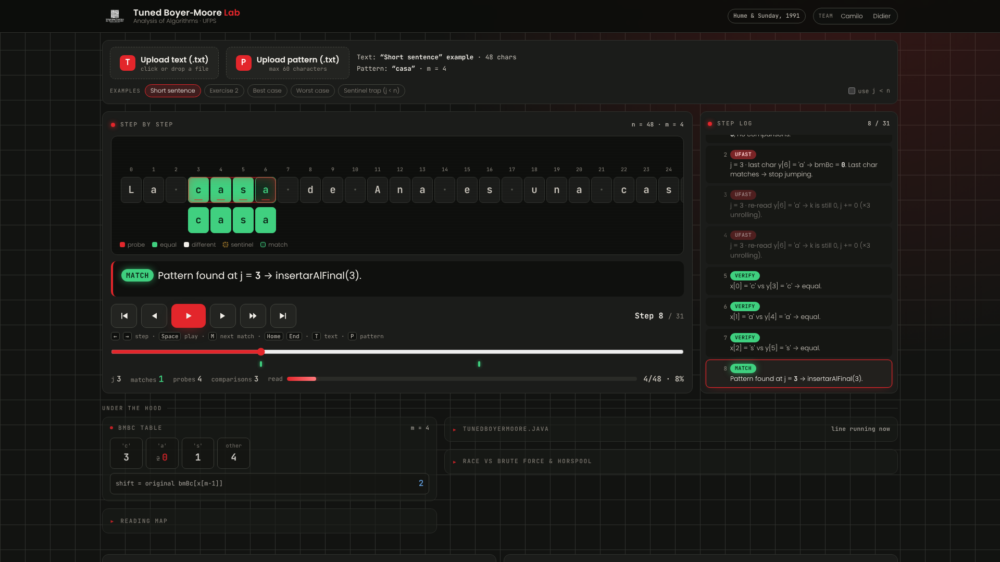

# Tuned Boyer-Moore Lab

An interactive, step-by-step simulator of the **Tuned Boyer-Moore** string matching algorithm (Hume & Sunday, 1991).

**Live version:** https://camilo0812a.github.io/tuned-boyer-moore-simulator/

**Repository:** https://github.com/Camilo0812A/tuned-boyer-moore-simulator

The page is a single self-contained `index.html`: no build step, no dependencies except Google Fonts.

## How it works

1. **Preprocessing (bmBc).** For each character of the pattern `x[0..m−2]`, `bmBc[c] = m − 1 − i` (last occurrence wins). Any other character gets `m`.
2. **Shift and the zero.** Save `shift = bmBc[x[m−1]]`, then set `bmBc[x[m−1]] = 0`. A zero now means "the last character of the window matches".
3. **Sentinel.** Append `m` copies of `x[m−1]` after the text. The fast loop always stops on them, so it needs no bounds check.
4. **Probe.** Read only the last character of the window, `y[j + m − 1]`, and look it up: `k = bmBc[...]`.
5. **ufast ×3.** While `k ≠ 0`, jump `j += k` and probe again — the loop is unrolled three times, so the window can skip whole blocks of text without a single comparison.
6. **Verify and shift.** If `j ≤ n − m` (never the sentinel), compare `x[0..m−2]` with the text by hand; if all are equal, report `j`. Then `j += shift` and repeat.

## How to use

1. Click **Upload text (.txt)** and **Upload pattern (.txt)** (or drop a file on each button). Files are read as UTF-8; the pattern may have up to 60 characters.
2. Step through the search with the controls or the keyboard:

| Key | Action |
| --- | --- |
| `→` / `←` | one step forward / back |
| `Space` | play / pause (fixed speed, ~480 ms per step) |
| `M` | jump to the next match |
| `Home` / `End` | first / last step |
| `T` | upload a text file |
| `P` | upload a pattern file |

You can also drag the timeline; green marks show where matches happen.

**Light / dark mode:** use the sun/moon button in the top bar. The page follows your system setting until you pick one, and remembers your choice.

**Examples** (small chips above the stage): *Short sentence* (`casa`, the default), *Exercise 2* (`CASA`), *Best case* (`SOL` in `MAR MAR …`), *Worst case* (`aaaa` in 24 `a`s) and *Sentinel trap (j < n)* — with Lecroq's `j < n` condition, `ESE` in `TU VES` produces a false match at `j = 4` that uses the sentinel.

## What you see

- **The tape** — text cells with indices, the dashed sentinel cells, and the pattern window sliding with a spring. Each jump draws an arc labeled `+k`; the probed character hops and glows red with a `+k` / `k = 0` badge (the redundant ufast re-reads are dimmed). During verification each compared pair turns green (equal) or white (different) in the text and the pattern at the same time; a match flashes green.
- **Narration** — one large sentence explaining the current step.
- **Step log** — every step is appended with its number, a colored tag (Probe, ufast, Verify, Match, Shift, Window out, Done) and the explanation. Going back removes entries; jumping re-syncs it. Click an entry to go to that step.
- **Under the hood** (secondary):
  - the **bmBc table**, lighting up the entry consulted by each probe, and the saved `shift`;
  - the **Java code** (`TunedBoyerMoore.java`) with the running line highlighted;
  - **counters** (window `j`, matches, probes, comparisons, % of text read);
  - the **reading map**: which characters were read by probes, by verification, or never;
  - a **race** on the whole text against brute force and Horspool (character reads and time).

## Differences with Horspool and Sunday

| | Horspool (1980) | Sunday (Quick Search, 1990) | Tuned Boyer-Moore (1991) |
| --- | --- | --- | --- |
| Character it looks at | last char of the window `y[j+m−1]` | char just after the window `y[j+m]` | last char of the window `y[j+m−1]` |
| Table | bmBc | qsBc | bmBc with `bmBc[x[m−1]] = 0` |
| Maximum shift | `m` | `m + 1` | `m` per jump, up to 3 jumps per round |
| When it compares | every window | every window | only when `k = 0` (last char matches) |
| End of the text | bounds check each step | bounds check each step | sentinel of `m` copies of `x[m−1]` |

## Complexity

| | |
| --- | --- |
| Preprocessing | O(m + σ) |
| Extra space | O(σ) |
| Search, worst case | O(n · m) |
| Search, best case | O(n / m) |
| Search, average | sublinear, like Horspool (fewer instructions per character thanks to the unrolled loop) |

## Authors

| Name | Email | Role | Links |
| --- | --- | --- | --- |
| **David Camilo Colmenares Hernandez** | [davidcamiloch@ufps.edu.co](mailto:davidcamiloch@ufps.edu.co) | Part I · How it works | [GitHub](https://github.com/Camilo0812A) · [LinkedIn](https://www.linkedin.com/in/camilo-colmenares-7b96a6281) |
| **Didier Olinto Jaimes Gómez** | [didierolintojg@ufps.edu.co](mailto:didierolintojg@ufps.edu.co) | Part II · Practice & analysis | [GitHub](https://github.com/DidierrJG) · [LinkedIn](https://www.linkedin.com/in/didier-olinto-jaimes-gomez-4a0255327) |

| | |
| --- | --- |
| Course | Analysis of Algorithms |
| Program | Systems Engineering |
| University | Universidad Francisco de Paula Santander (UFPS) |
| Professor | Marco Antonio Adarme Jaimes |
| Location | Cúcuta, Norte de Santander, Colombia |
| Date | November 25, 2026 |
| Repository | https://github.com/Camilo0812A/tuned-boyer-moore-simulator |

## References

- A. Hume and D. Sunday. *Fast string searching.* Software: Practice and Experience, 21(11):1221–1248, 1991.
- R. S. Boyer and J. S. Moore. *A fast string searching algorithm.* Communications of the ACM, 20(10):762–772, 1977.
- R. N. Horspool. *Practical fast searching in strings.* Software: Practice and Experience, 10(6):501–506, 1980.
- D. M. Sunday. *A very fast substring search algorithm.* Communications of the ACM, 33(8):132–142, 1990.
- C. Charras and T. Lecroq. *Handbook of Exact String Matching Algorithms.* King's College Publications, 2004.
